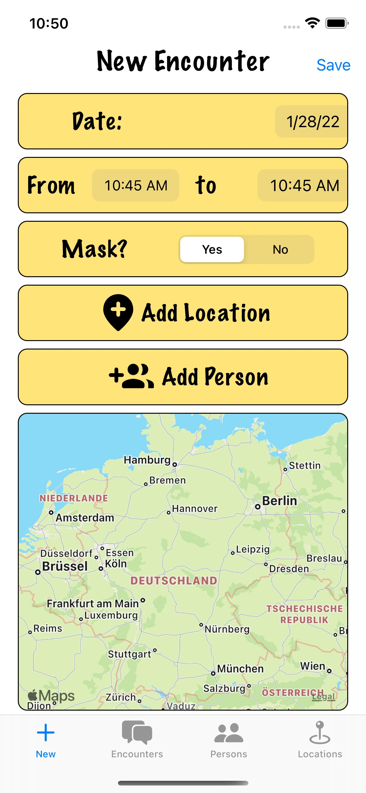
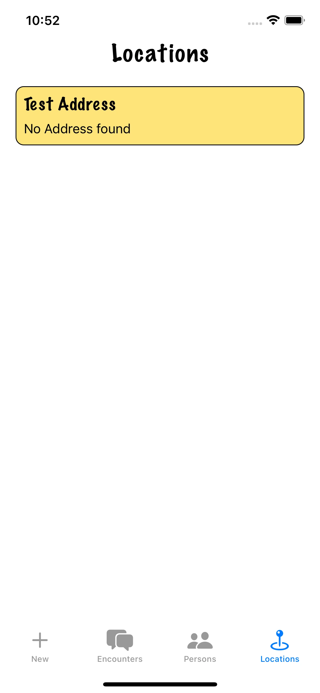

<!-- portfolio:date=2021-02-01 -->
# Contact Log (Kontakttagebuch)

**[English](README.md) · [Deutsch](README.de.md)**

<p align="center">
  
  
  
  
</p>

Eine native iOS-App in Swift mit UIKit und Core Data zur lokalen Dokumentation persönlicher Kontakte, Orte und Begegnungshistorien direkt auf dem Gerät.

## Highlights

- **Relationale Core-Data-Persistenz** — modelliert `Person`, `Location` und `Encounter` in `Kontakttagebuch.xcdatamodeld` (`Core Data`), sodass alle Begegnungen lokal und offline durchsuchbar bleiben.
- **GPS-Reverse-Geocoding** — `Network.swift` ruft über `URLSession` die Google Geocoding API auf, um beim Anlegen neuer Orte Koordinaten automatisch in formatierte Adressen aufzulösen.
- **Modulare UIKit-Controller & eigene Tabellenzellen** — spezialisierte `UIViewController` (`EncountersViewController`, `LocationsViewController`, `PersonsViewController`) mit wiederverwendbaren `.xib`-`UITableViewCell`-Komponenten in `Xcode`.
- **Unit-Tests für Eingabeabläufe** — `KontakttagebuchTestsUnit` prüft das Anlegen von Kontakten und Orten (`AddLocationTest`, `AddPersonTest`).

## Architektur

```
UIKit ViewControllers & .xib Table Cells (Begegnungen · Personen · Orte)
         │
         ├──► Core-Data-Stack (AppDelegate / Kontakttagebuch.xcdatamodeld)
         │        Entitäten: Person · Location · Encounter
         │
         └──► Adress-Geocoder (Network.swift per URLSession → Google Geocoding API)
```

## Tech-Stack

Swift · iOS · Mobile App · UIKit · Core Data · URLSession · Xcode · XCTest

## Einrichtung

```bash
open Kontakttagebuch/Kontakttagebuch.xcodeproj   # In Xcode öffnen und im iOS-Simulator starten
```

Mit `Cmd+U` lassen sich die Unit-Tests in `KontakttagebuchTestsUnit` direkt in Xcode ausführen.
