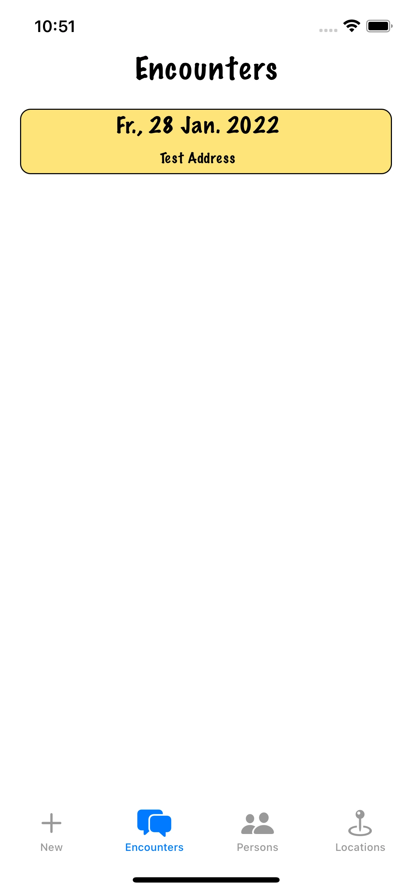
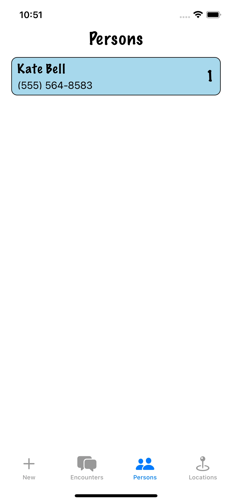

<!-- portfolio:date=2021-02-01 -->

[Deutsch](README.de.md) · [English](README.md)

# Kontakttagebuch

Eine native iOS-App zum Protokollieren persönlicher Kontakte und Interaktionsverläufe, entwickelt mit Swift und Core Data.

## Screenshots

  
  
  
  

### Funktionen

- **Kontaktverwaltung** mit Name, Telefon, E-Mail und Notizen
- **Interaktionsverlauf** zur Dokumentation vergangener Gespräche und Treffen
- **Core Data** für persistente lokale Datenspeicherung
- **Suchfunktion** zum schnellen Auffinden von Kontakten
- **Native iOS UI** mit UIKit und Auto Layout

### Hintergrund

Das Projekt entstand als Übung zur iOS-Entwicklung mit Swift, mit besonderem Fokus auf Core Data als Persistenz-Framework und die Integration nativer iOS-Designmuster.
