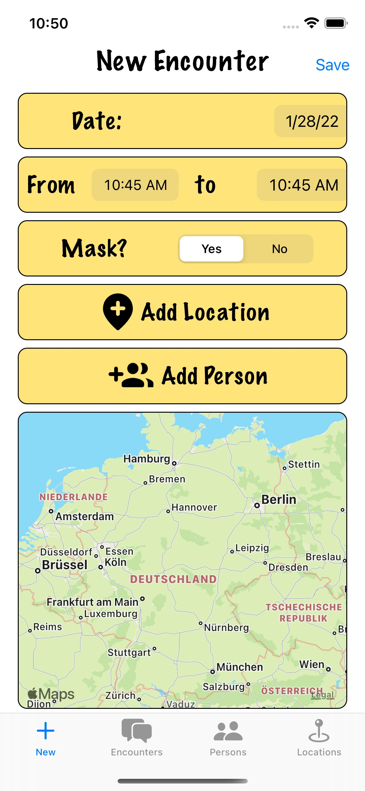
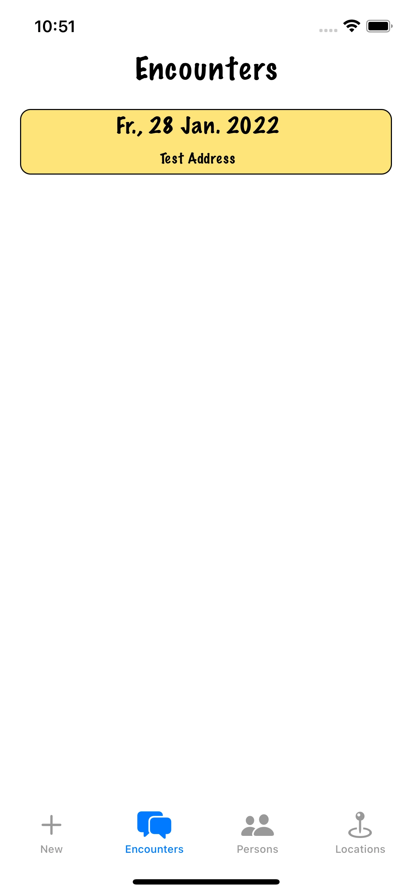
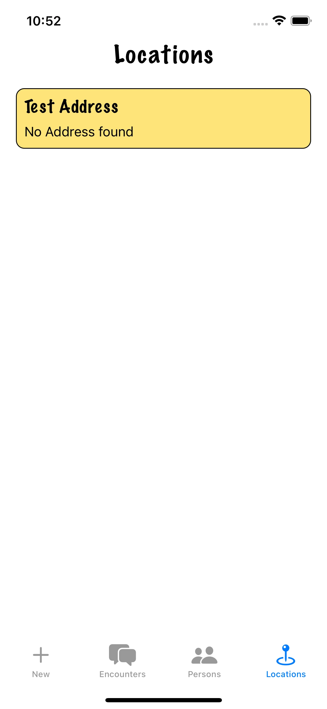
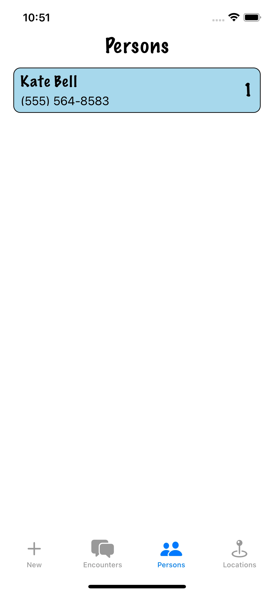

<!-- portfolio:date=2021-02-01 -->
# Contact Log (Kontakttagebuch)

**[English](README.md) · [Deutsch](README.de.md)**

<p align="center">
  
  
  
  
</p>

A native iOS mobile app written in Swift with UIKit and Core Data for logging personal contacts, locations, and chronological encounter timelines locally on device.

## Highlights

- **Relational Core Data persistence** — models `Person`, `Location`, and `Encounter` entities in `Kontakttagebuch.xcdatamodeld` (`Core Data`) so meeting histories stay queryable offline on the device.
- **GPS reverse-geocoding helper** — `Network.swift` calls Google's Geocoding REST API via `URLSession` to convert latitude/longitude coordinates into formatted street addresses when logging a location.
- **Modular UIKit controllers & custom cells** — dedicated `UIViewController` screens (`EncountersViewController`, `LocationsViewController`, `PersonsViewController`, `AddEncounterViewController`) paired with reusable `.xib` `UITableViewCell` components built in `Xcode`.
- **Unit-tested persistence flows** — `KontakttagebuchTestsUnit` verifies location and contact creation logic (`AddLocationTest`, `AddPersonTest`).

## Architecture

```
UIKit ViewControllers & Custom .xib Table Cells (Encounters · Persons · Locations)
         │
         ├──► Core Data Stack (AppDelegate / Kontakttagebuch.xcdatamodeld)
         │        Entities: Person · Location · Encounter
         │
         └──► Address Geocoder (Network.swift via URLSession → Google Geocoding API)
```

## Tech Stack

Swift · iOS · Mobile App · UIKit · Core Data · URLSession · Xcode · XCTest

## Getting Started

```bash
open Kontakttagebuch/Kontakttagebuch.xcodeproj   # Build and run in Xcode (iOS Simulator or device)
```

Run `Cmd+U` in Xcode to execute the `KontakttagebuchTestsUnit` suite.
